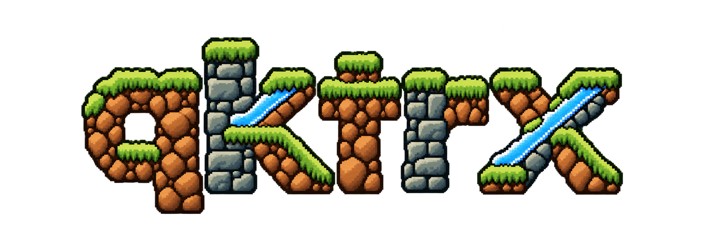

 

# qktrx

qktrx (pronounced "quack tracks") is the course editor for
[13 Duck Race](https://13duckrace.com/). Build your own race course, try it out,
and tweak it until it plays the way you want.

## Get the editor

### Mac

[**Download qktrx for Mac**](https://github.com/kelev-games/qktrx-releases/releases/download/v0.1.2/qktrx-0.1.2-darwin-arm64.dmg)

This beta is for Macs with an Apple M-series chip. To check yours, open the Apple
menu and choose **About This Mac**.

1. Open the downloaded file.
2. Drag **qktrx** into **Applications**.
3. Open **qktrx** from Applications and choose a course to start editing.

[What's in the Mac beta](https://github.com/kelev-games/qktrx-releases/releases/tag/v0.1.2)

### Ubuntu

The Ubuntu 24.04 beta is available to approved testers on 64-bit Intel and AMD
computers. Ask the qktrx team for access if you’re testing with us. A public Snap
Store download is still pending.

[Install or update on Ubuntu](docs/ubuntu.md)

## Use qktrx with an AI assistant

The optional companion lets tools like Codex connect to the editor and help
inspect or edit a course. You can build and test courses in the editor on its own.

[Set up the optional companion](docs/companion.md)
